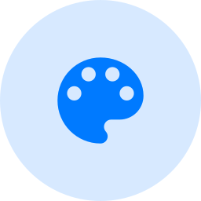
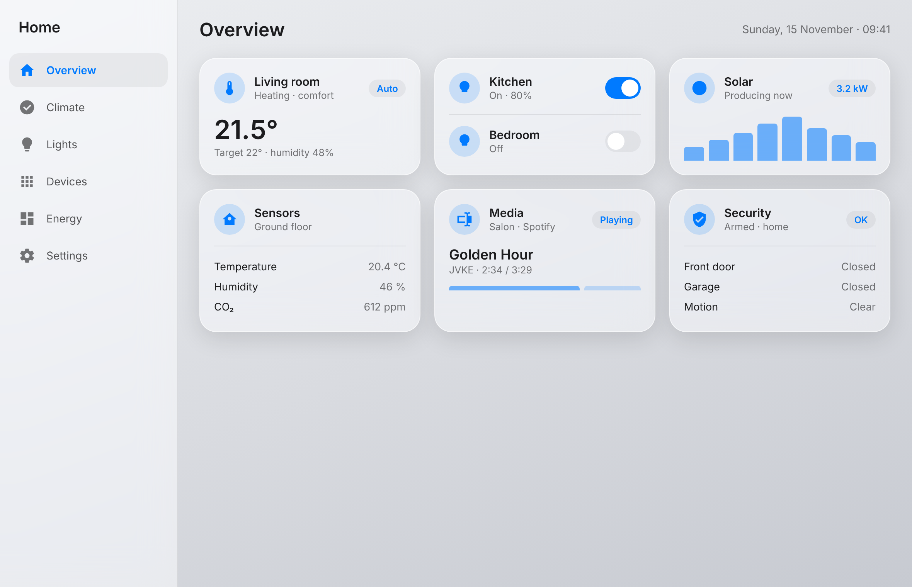
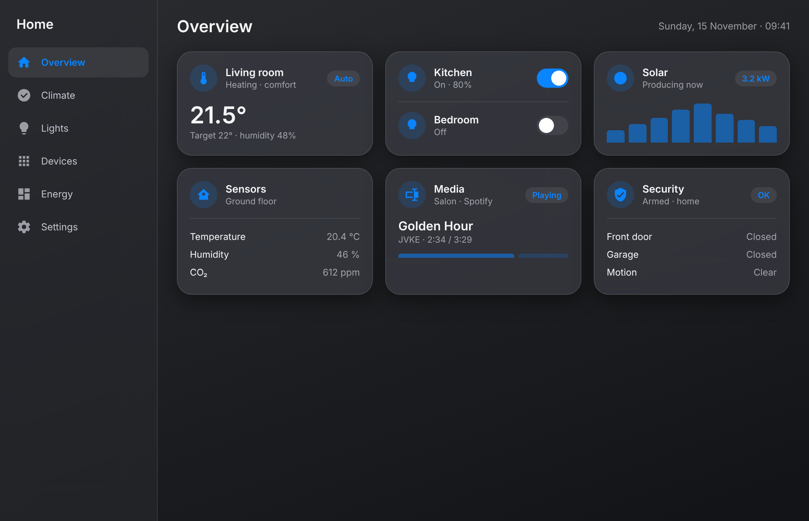
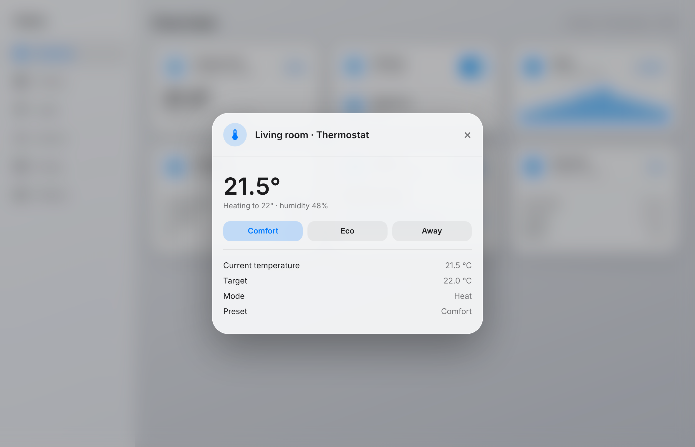
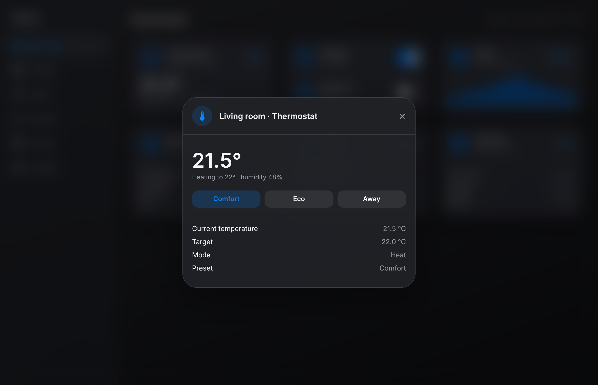

# ha-liquid-glass

[](https://www.home-assistant.io/integrations/marketplace/)
[](https://github.com/juju35/ha-liquid-glass/actions/workflows/hacs.yml)
[](https://github.com/juju35/ha-liquid-glass/actions/workflows/validate.yml)
[](https://github.com/juju35/ha-liquid-glass/releases/latest)
[](https://github.com/juju35/ha-liquid-glass/blob/main/LICENSE)
[](https://buymeacoffee.com/julienstep9)

<p align="center"></p>

An Apple-style **Liquid Glass** theme for Home Assistant: frosted, translucent cards and side panel floating over a soft **gray gradient**, in **light and dark** modes. The glass is kept subtle so that cards and panels stay fully legible — high-contrast text, clear icons, and borders that lift every card off the background.

[](https://my.home-assistant.io/redirect/marketplace_repository/?owner=juju35&repository=ha-liquid-glass&category=theme)

| Light | Dark |
|---|---|
|  |  |

A more-info dialog stays readable: the surface is nearly opaque and the dashboard behind it is blurred and dimmed.

| Light | Dark |
|---|---|
|  |  |

## Features

- **Frosted-glass** cards and side panel: translucent surfaces with a `backdrop-filter` blur and saturation, so what is behind shows through softly.
- **Gray gradient** background, different for light and dark, that the glass picks up.
- **Readable first**: high-contrast primary text, dimmed secondary text, state icons and a light border on every card so content never gets lost on the glass.
- **Readable dialogs**: more-info and other popups use a nearly opaque surface, and the background is blurred and dimmed behind them, so they never get lost in the glass.
- **Light and dark** modes in one theme (`modes:`), following Home Assistant's auto setting.
- **Readable state colors**: the status palette of the ha-* cards (green OK, amber active, blue open, cyan cold, purple media, red alert, gray idle), the same as the ha-neutral theme — darker on the light glass, brighter on the dark one — with matching `rgb-*` variables.
- Apple-blue accent, 22px rounded cards, translucent, frosted app header; the selected side-panel item is tinted with the accent.

## Prerequisites

Home Assistant 2024.1 or later. The glass effect uses the CSS `backdrop-filter`; where a browser does not support it, the cards fall back to a solid translucent color and stay readable.

## Installation

### Via the Marketplace (recommended)

Click the button below to add the repository directly:

[](https://my.home-assistant.io/redirect/marketplace_repository/?owner=juju35&repository=ha-liquid-glass&category=theme)

Then click **Download**, and restart Home Assistant.

Or manually:

1. Open **Settings → Marketplace → Add from link** (top right; this needs a GitHub account connected)
2. Add `https://github.com/juju35/ha-liquid-glass` — Type: **Theme**
3. Open **Liquid Glass** and click **Download**
4. Restart Home Assistant

The Marketplace copies the theme to `/config/themes/`.

### Manual

1. Copy `themes/liquid-glass.yaml` into your `config/themes/` folder.
2. Make sure `configuration.yaml` loads the themes folder:
   ```yaml
   frontend:
     themes: !include_dir_merge_named themes
   ```
3. Restart Home Assistant.

## Usage

1. Open your **Profile** (bottom left).
2. Under **Theme**, choose **Liquid Glass**.
3. The **Auto** / **Light** / **Dark** switch next to it selects the mode; **Auto** follows your system.

Applied per user, the choice is remembered on the device. To set it on a dashboard or for everyone, use the `frontend.default_theme` option or a `theme:` on a view.

## How it works

The theme ships a single file, `themes/liquid-glass.yaml`, defining one theme (`Liquid Glass`) with a `modes:` block for `light` and `dark`. It sets Home Assistant's own theme variables — `lovelace-background` (the gray gradient), `ha-card-background` and `ha-card-backdrop-filter` (the translucent, blurred cards), the `sidebar-*` variables (the glass side panel), the text and accent colors, and the status palette (`green-color`, `amber-color`… with their `rgb-*` twins, from which Home Assistant derives its state colors) — so every built-in and most custom cards inherit the look without per-card configuration.

## License

[MIT](LICENSE)
